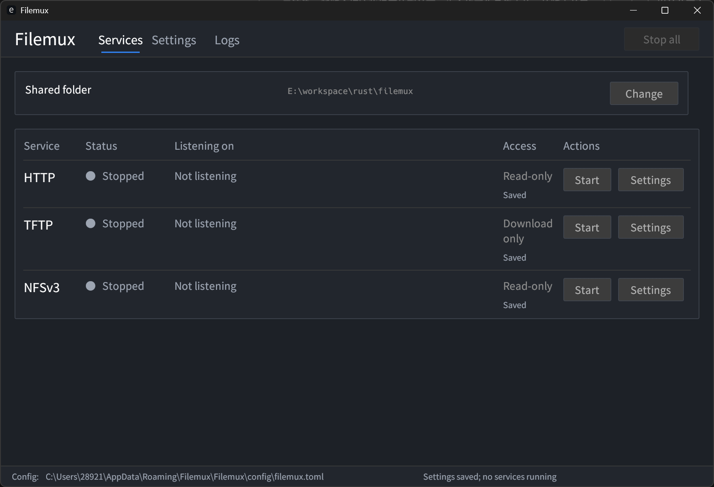
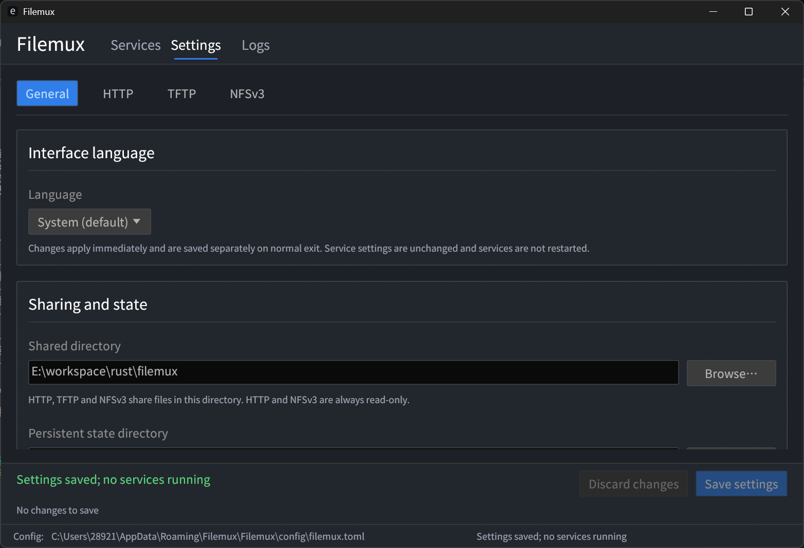

[English](#english) | [简体中文](#chinese)

# Filemux

<a id="english"></a>

## English

A cross-platform file server written in Rust for boot-file distribution and trusted-LAN sharing. Filemux provides a CLI and a native egui desktop app on Windows, Linux and macOS, without requiring a host kernel NFS server.

<a id="screenshots"></a>



<details>
<summary>Settings and language</summary>



</details>

Screenshots show the current development version.

| Protocol | Transport and default ports | Access |
| --- | --- | --- |
| HTTP | TCP 8080 | Read-only: directory browsing, GET, HEAD and single byte ranges. |
| TFTP | UDP 69; dynamic UDP data ports | Octet transfers with `blksize`, `timeout` and `tsize`. Uploads are opt-in and never overwrite files. |
| NFSv3 / MOUNTv3 | TCP/UDP 2049; optional portmapper v2 on 111 | Read-only, with persistent file handles and subdirectory mounts. |

### Install

Download a package for Windows x64, Linux x64, macOS Intel or Apple Silicon from [GitHub Releases](https://github.com/lona-cn/filemux/releases) and verify its `SHA256SUMS`. Packages include `filemux` and `filemux-gui` (`.exe` on Windows); Rust is not required. Binaries are unsigned, and Linux packages are not fully static.

Or install either application from crates.io:

```sh
cargo install filemux-cli --locked
cargo install filemux-gui --locked
```

The CLI package installs the **`filemux`** command; the GUI installs **`filemux-gui`**. Add `$CARGO_HOME/bin` to `PATH` (normally `~/.cargo/bin`, or `%USERPROFILE%\.cargo\bin` on Windows). The CLI does not pull in GUI dependencies.

Source builds need Rust and a platform C/C++ toolchain; SQLite is bundled. GUI builds also need MSVC on Windows, Xcode Command Line Tools on macOS, or `pkg-config` and X11/Wayland development libraries on Linux. A graphical environment and drivers are required to run the GUI.

### Quick start

Keep persistent state outside the shared directory:

```sh
mkdir share
filemux --config filemux.toml init --root ./share --state-dir ./.filemux-state
filemux --config filemux.toml check
filemux --config filemux.toml serve
```

Place files in `share` and open <http://127.0.0.1:8080/>. The initial configuration enables **HTTP only**, bound to localhost. Press Ctrl+C to stop. `init` never overwrites a configuration; `check` does not start services or test port availability. See the [configuration example](examples/filemux.toml); relative paths are resolved from the configuration file.

Enable TFTP uploads on a local high port:

```sh
filemux --config filemux.toml serve --tftp-bind 127.0.0.1:1069 --allow-upload
```

Overrides affect only this run. `--no-http` disables HTTP; `--json` reports actual ready endpoints. Enabling TFTP uploads does not change HTTP or NFS permissions.

### Desktop app

Run the current GUI from source:

```sh
cargo run -p filemux-gui -- --config filemux.toml
```

Configure paths and protocols in **Settings**, then start services on **Services**. **Logs** supports protocol and error filters. Opening the window does not start services. Saving settings does not reconfigure running services: stop all services, then start them to use new settings. The CLI default protocol options do not control GUI service switches.

The interface follows the system language, with **English** and **简体中文** available under **Settings → General → Interface language**. Language changes apply immediately and are saved separately on normal exit; service settings are unaffected. Raw logs and system diagnostics retain their original text. Closing the window stops its own services, not a separate CLI process.

### NFS clients

High-port example with explicit NFS and MOUNT ports, without port discovery:

```sh
filemux --config filemux.toml serve --nfs-bind 127.0.0.1:12049 --no-rpcbind
sudo mount -t nfs -o ro,vers=3,proto=tcp,mountproto=tcp,port=12049,mountport=12049,nolock,noacl 127.0.0.1:/ /mnt/filemux
```

Create the client mount point first. For LAN access, replace localhost in both commands with the server's interface IP. Standard-port setups with discovery can omit `port` and `mountport`. macOS uses `mount_nfs` and `nolocks`; NFS/UDP clients can use `rsize=32768`.

Keep the original shared root, objects and state directory to reuse NFS handles after a restart, with suitable client retries such as Linux `hard` mounts. Use a different state directory for a different shared root; do not delete active state.

### Security and limitations

- **Trusted networks only.** TFTP has no user authentication; NFS AUTH_SYS does not verify remote UID/GID claims. Neither is encrypted, and HTTP does not provide HTTPS. File access remains subject to the server process's host permissions.
- Bind to the server's specific interface for LAN access. Low ports may require privileges; Filemux does not elevate itself, change firewall rules or replace system rpcbind. TFTP firewall rules must allow dynamic data ports too.
- Native file creation times are required. Windows currently requires NTFS and exposes virtual `0555` permissions, not full POSIX/ACL semantics; Linux file reads rely on `/proc/self/fd`. Directory scans are limited to 10,000 entries. Read-only rootfs writes need client-side tmpfs/OverlayFS or equivalent.
- No DHCP/PXE, NFSv2/v4, NLM/statd, Kerberos or rootfs image conversion. U-Boot hardware and complete diskless boot have not been validated.

### Development

Three crates: **`filemux-core`** for configuration, filesystem access and protocol services; **`filemux-cli`** and **`filemux-gui`** share that engine.

```sh
cargo build --workspace --locked
cargo test --workspace --locked
cargo fmt --all -- --check
```

Rust 1.88 / edition 2024 is declared; CI uses Rust 1.99.0. The minimum version has not been separately tested. See [scope](docs/phase-1.md), [verification records](docs/progress.md), [CI](.github/workflows/ci.yml) and the [release workflow](.github/workflows/release.yml).

### License

**MIT OR Apache-2.0** — see [LICENSE](LICENSE). The bundled Noto Sans SC font is separately licensed under [SIL OFL 1.1](crates/filemux-gui/assets/fonts/OFL.txt).

---

<a id="chinese"></a>

## 简体中文

Rust 编写的跨平台文件共享服务，面向可信局域网中的启动文件分发与 NFS 文件访问。提供 CLI 和 egui 原生桌面界面，支持 Windows、Linux、macOS，不依赖宿主机内核 NFS 服务端。[查看界面截图](#screenshots)。

| 协议 | 传输与默认端口 | 访问权限 |
| --- | --- | --- |
| HTTP | TCP 8080 | 只读：目录浏览、GET、HEAD、单段字节 Range。 |
| TFTP | UDP 69；数据使用动态 UDP 端口 | octet 传输，支持 `blksize`、`timeout`、`tsize`；上传默认关闭，开启后也不覆盖已有文件。 |
| NFSv3 / MOUNTv3 | TCP/UDP 2049；可选 portmapper v2 使用 111 | 只读，支持持久文件句柄与子目录挂载。 |

### 安装

从 [GitHub Releases](https://github.com/lona-cn/filemux/releases) 下载 Windows x64、Linux x64、macOS Intel 或 Apple Silicon 压缩包，按同一 Release 的 `SHA256SUMS` 校验。包内包含 `filemux` 和 `filemux-gui`（Windows 使用 `.exe`），无需 Rust；二进制未签名，Linux 包不是完全静态构建。

也可从 crates.io 独立安装任一程序：

```sh
cargo install filemux-cli --locked
cargo install filemux-gui --locked
```

CLI 包安装的命令名为 **`filemux`**；GUI 命令名为 **`filemux-gui`**。请将 `$CARGO_HOME/bin` 加入 `PATH`（默认通常为 `~/.cargo/bin`，Windows 为 `%USERPROFILE%\.cargo\bin`）。安装 CLI 不引入 GUI 依赖。

源码构建需要 Rust 和平台 C/C++ 工具链，SQLite 随源码编译。GUI 在 Windows 另需 MSVC、macOS 需 Xcode Command Line Tools、Linux 需 `pkg-config` 及 X11/Wayland 开发库；运行需要图形环境与驱动。

### 快速开始

将持久状态放在共享目录之外：

```sh
mkdir share
filemux --config filemux.toml init --root ./share --state-dir ./.filemux-state
filemux --config filemux.toml check
filemux --config filemux.toml serve
```

将文件放入 `share`，访问 <http://127.0.0.1:8080/>。初始配置**仅启用 HTTP**，只监听本机；按 Ctrl+C 停止。`init` 不覆盖已有配置，`check` 不启动服务或检查端口是否可用。完整配置见 [配置示例](examples/filemux.toml)，相对路径以配置文件所在目录为准。

在本机高端口启用 TFTP 上传：

```sh
filemux --config filemux.toml serve --tftp-bind 127.0.0.1:1069 --allow-upload
```

参数仅覆盖本次运行；`--no-http` 禁用 HTTP，`--json` 输出实际就绪地址。开启 TFTP 上传不改变 HTTP、NFS 的只读权限。

### 桌面界面

从源码运行当前 GUI：

```sh
cargo run -p filemux-gui -- --config filemux.toml
```

在**设置**中配置目录与协议，再到**服务**页启动；**日志**页支持协议和错误筛选。打开窗口不自动启动服务，保存设置不改变运行中的服务；使用新设置需先全部停止，再重新启动。“CLI 默认启用协议”不控制 GUI 服务开关。

界面默认跟随系统语言，可在**设置 → 通用 → 界面语言**选择 **English / 简体中文**。选择立即生效，正常关闭时单独保存，不修改服务配置；原始日志和系统诊断保留原文。关闭窗口会停止其内部服务，不管理独立 CLI 进程。上方截图为当前开发版本。

### NFS 客户端

使用高端口、关闭端口发现，由客户端显式指定 NFS 和 MOUNT 端口：

```sh
filemux --config filemux.toml serve --nfs-bind 127.0.0.1:12049 --no-rpcbind
sudo mount -t nfs -o ro,vers=3,proto=tcp,mountproto=tcp,port=12049,mountport=12049,nolock,noacl 127.0.0.1:/ /mnt/filemux
```

请先创建客户端挂载点。局域网使用时，将两条命令中的本机地址改为服务器网卡 IP；使用标准端口并启用发现时可省略 `port`、`mountport`。macOS 使用 `mount_nfs` 和 `nolocks`；NFS/UDP 客户端可使用 `rsize=32768`。

保留原共享根、对象与完整状态目录，并采用适当的客户端重试策略（如 Linux `hard` 挂载），可在服务重启后复用旧句柄。更换共享根应使用另一状态目录，不要删除使用中的状态。

### 安全与限制

- **仅用于可信网络。** TFTP 无用户认证，NFS AUTH_SYS 不验证远程 UID/GID 声明，两者均不加密，HTTP 不提供 HTTPS。实际文件访问仍受服务端进程的宿主权限限制。
- 局域网共享应绑定具体网卡 IP。低端口可能需要额外权限；程序不自动提权、改防火墙或替换系统 rpcbind。TFTP 防火墙规则还需放行动态数据端口。
- 文件系统需提供原生创建时间。Windows 当前要求 NTFS，对外虚拟权限为 `0555`，不等价于完整 POSIX/ACL；Linux 文件读取依赖 `/proc/self/fd`。目录扫描上限为 10,000 项；只读 rootfs 的写入需由客户端通过 tmpfs、OverlayFS 等处理。
- 不提供 DHCP/PXE、NFSv2/v4、NLM/statd、Kerberos 或 rootfs 镜像转换。U-Boot 真机与完整无盘启动尚未验证。

### 开发

Workspace 仅包含三个 crate：**`filemux-core`** 负责配置、文件系统与协议服务，**`filemux-cli`** 和 **`filemux-gui`** 共用该服务引擎。

```sh
cargo build --workspace --locked
cargo test --workspace --locked
cargo fmt --all -- --check
```

清单声明 Rust 1.88、edition 2024；CI 使用 Rust 1.99.0，未单独验证最低版本。实现范围见 [阶段说明](docs/phase-1.md)，验证记录见 [进度文档](docs/progress.md)；自动化见 [CI](.github/workflows/ci.yml) 与 [Release 工作流](.github/workflows/release.yml)。

### 许可证

源码采用 **MIT OR Apache-2.0**，条款见 [LICENSE](LICENSE)。内置 Noto Sans SC 字体单独遵循 [SIL OFL 1.1](crates/filemux-gui/assets/fonts/OFL.txt)。
